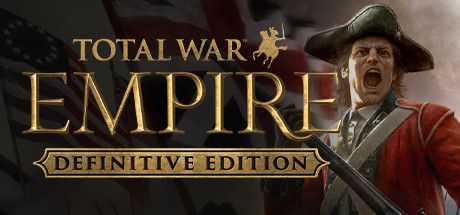

**Total War: EMPIRE spans the 18th century, letting you command European powers, trade companies, and colonial empires in an era of muskets, cannon, and naval supremacy. Features the most complex political and trade systems in the series.**

---

## 📖 About

Total War: EMPIRE spans the 18th century, letting you command European powers, trade companies, and colonial empires in an era of muskets, cannon, and naval supremacy. Features the most complex political and trade systems in the series.

## ⚠️ Problems Without Trainer

| Problem | Status |
|---------|--------|
| **AI Naval Combat** — Computer opponents make poor naval decisions and feel exploitable | ✅ Solved |
| **Campaign Stability** — Older title has occasional crashes during long campaigns | ✅ Solved |
| **Tech Tree Length** — Researching all technologies requires very long campaign playthroughs | ✅ Solved |
| **Diplomacy Chaos** — Alliance chains drag entire map into unwinnable wars quickly | ✅ Solved |

## ✅ Solution

The **Total War: EMPIRE Trainer** solves all these issues by giving you complete control over the game.

## 🎯 Full Feature List

- Unlimited Resources
- God Mode / Invincibility
- Instant Skill Cooldown
- One-Hit Kill
- Freeze Game Timer
- Unlock All Items & Achievements
- Custom Speed Multiplier
- Save State Anywhere

## 🚀 Quick Start

1. **Disable Windows Defender** temporarily (trainer may trigger false positive)
2. Download the trainer from the button above
3. Launch Total War: EMPIRE
4. Run the trainer as Administrator
5. Activate desired cheats with hotkeys

## 💎 Free vs Paid

| Feature | Free | Pro |
|---------|------|-----|
| Basic God Mode | ✅ | ✅ |
| Unlimited Resources | ✅ | ✅ |
| All Advanced Cheats | ❌ | ✅ |
| Auto-Updates | ❌ | ✅ |
| Priority Support | ❌ | ✅ |

## 💻 Requirements

- Windows 10/11 (64-bit)
- Total War: EMPIRE (any version)
- .NET Framework 4.8+
- DirectX 11+

## 🍎 macOS

macOS users can use our alternative tool:

## ⚖️ Legal

This trainer is for educational and single-player use only. Use responsibly.

---

